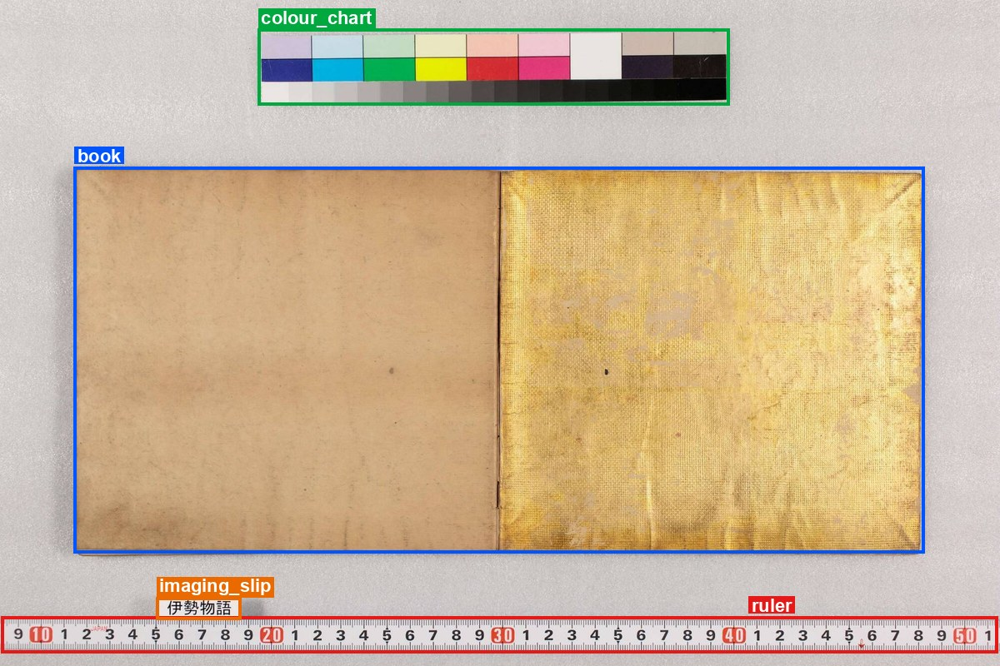

# shohon-framing-bbox

[](https://colab.research.google.com/github/nakamura196/shohon-framing-bbox/blob/main/notebooks/try_in_colab.ipynb)
[](https://github.com/nakamura196/shohon-framing-bbox/actions/workflows/ci.yml)
[](https://doi.org/10.5281/zenodo.24181285)



*Output of `shohon-bbox detect` on* Ise monogatari, *Keio University Library Fujikawa Collection
(Kokusho Database `bid` 300120319, frame 2; CC BY 4.0). To try it on this or your own image without
installing anything, open the notebook in Google Colab with the button above.*

Boxes for the **book**, **colour charts**, **rulers** and **imaging slips** in digitized images of
books, without training a detector for the task.

Images of Japanese classical books published by libraries and archives usually show more than the
book: a colour chart, a ruler and a slip with the shelf mark lie next to it. To crop the book, or to
use the chart and ruler for colour and scale, each of them needs a box. `shohon-bbox` draws these
boxes by combining three openly available detectors (Grounding DINO, OWLv2 and YOLOv8-NDL-Layout)
and filtering their output with spatial rules (one book; charts, rulers and slips outside it; an
L-shaped ruler as two boxes).

On 102 images from 102 books in the Kokusho Database, the boxes reached F1 0.919 at IoU 0.50, and
89% of the ground-truth boxes could be used without adjustment (IoU ≥ 0.80). The method and its
limits are described in the accompanying paper (under review; see [Citation](#citation)).

The repository contains

- `src/shohon_bbox/` — the package: detection (`detect`), the spatial rules, IIIF input and
  Web Annotation output, the review interface with its blind mode (`review`), and the scoring used
  in the paper (`evaluate`)
- `data/` — the dataset of the paper (CC BY 4.0): ground truth for 102 images, blind annotations of
  20 images by two annotators, the raw detector outputs and the predictions of all seven configurations
- `paper/` — the scripts of the paper: `reproduce.py` reproduces its tables from `data/`;
  `fetch_images.py` downloads the 102 evaluation images from their IIIF servers and checks them
  against the recorded SHA-256; `yolo_cv.py` trains and cross-validates YOLO11x (Configuration 7);
  `negatives.py` draws and scores the images without rulers or charts (Section 4.3);
  `time_inference.py` measures inference time
- `notebooks/try_in_colab.ipynb` — a notebook to try the detector on one image

## Install

```
pip install "shohon-bbox[detect] @ git+https://github.com/nakamura196/shohon-framing-bbox"
```

Python 3.10 or later. The `detect` extra installs PyTorch, Transformers and Ultralytics. The three
models (about 1 GB) are downloaded from the Hugging Face Hub on first use, at the revisions used
in the paper. Scoring and the rules alone need no extra dependencies.

## Use

An image file or image URL:

```
shohon-bbox detect page.jpg
```

A Canvas of a IIIF manifest (1-based position or Canvas id). Boxes are returned in Canvas
coordinates, with a `#xywh=` fragment for each:

```
shohon-bbox detect https://kokusho.nijl.ac.jp/biblio/300120319/manifest --canvas 2
```

```json
{
  "target": "https://kokusho.nijl.ac.jp/biblio/300120319/canvas/1",
  "width": 6480, "height": 4320,
  "boxes": [
    {"class": "book", "score": 0.9253, "source": "ndl", "xywh": [480, 1084, 5513, 2504],
     "fragment": "https://kokusho.nijl.ac.jp/biblio/300120319/canvas/1#xywh=480,1084,5513,2504"},
    {"class": "colour_chart", "score": 0.5786, "source": "gdino", "xywh": [1670, 188, 3059, 495], "...": "..."},
    {"class": "ruler", "score": 0.5475, "source": "gdino", "xywh": [9, 4001, 6459, 233], "...": "..."},
    {"class": "imaging_slip", "score": 0.5291, "source": "owlv2", "xywh": [1010, 3872, 551, 146], "...": "..."}
  ]
}
```

Options:

- `--format annotation` writes a IIIF Presentation 3 / W3C Web Annotation page (one `tagging`
  annotation per box) that IIIF viewers can display
- `--ruler true|false` and `--colour-chart true|false` pass known presence of a ruler or chart
  (Configuration 6 of the paper), for example from catalogue metadata
- `--max-side` sets the long side of the image used for detection (default 1,400 pixels, as in the paper)

Detection takes about 4 seconds per image on a laptop CPU. Results on other hardware or library
versions can differ slightly from the paper's.

## Review the boxes

Drafts are rarely all right. `shohon-bbox review` opens a local web page on which each draft can
be corrected (move, resize, delete, add or relabel boxes, then mark the image as verified). The
drafts of all configurations stay available from a menu. In blind mode no draft or score is shown
and boxes are drawn on a blank image into a separate file, to measure how much the drafts bias
the result or to collect a second annotator's boxes. The ground truth of the paper was made this way.

```
shohon-bbox detect images/*.jpg --format raw > raw.json      # drafts for a folder of images
shohon-bbox review images/ --drafts raw.json --out annotations.json
```

Open the printed address (http://127.0.0.1:8795/). Every change is saved at once to
`annotations.json` (blind mode: `blind_annotations.json`). Boxes are in pixels of the image used
for detection; the file records that size for each image.

## Score

```
shohon-bbox evaluate --pred predictions.json --gold annotations.json --out results/
```

Ground truth and predictions can be JSON (a file saved by `review` counts verified images only)
or CSV files in the format of `data/`, for example
`shohon-bbox evaluate --pred data/predictions/config5_proposed.csv --gold data/gold/gold102.csv --out results/`.

## What it does and does not do

The classes follow the convention of the Kokusho Database images: `book` (the opening, cover,
scroll section, attached certificate or box), `colour_chart` (colour charts and grey scales),
`ruler` (each arm of an L-shaped ruler separately) and `imaging_slip` (slips placed outside the
book). Frame-number plates are not a class; on images without rulers or charts they are the main
source of false boxes. The rules were set on images of one database; other collections may need
other thresholds. See the paper's Limitations section.

## Reproducing the paper

```
pip install -e ".[test]" pillow
python paper/reproduce.py
```

This recomputes Configurations 1–6 from the stored raw detector outputs, checks them box for box
against `data/predictions/`, scores all seven configurations against the ground truth, and checks
every value against the paper. It also redraws the 74 images without rulers or charts of Section
4.3, recounts the false detections on them, and checks the cross-validation folds of
Configuration 7. It downloads one file (26 MB) of the companion dataset from Zenodo. The check also
runs in CI.

Steps that need the images, the models or a GPU are not run in CI; each script's header gives the
commands and the software versions of the paper's run:

- `python paper/fetch_images.py --out images/` — the 102 evaluation images
- `python paper/yolo_cv.py prepare --images-dir images/ --kit kit/`, then `train` on a GPU —
  Configuration 7 (the paper's out-of-fold predictions are `data/predictions/config7_yolo11x.csv`)
- `python paper/negatives.py fetch --dir neg/` and `detect` — the raw outputs of Section 4.3
- `python paper/time_inference.py --images-dir images/` — inference time on the CPU

## Citation

See `CITATION.cff`. The software is archived on Zenodo: https://doi.org/10.5281/zenodo.24181285
(all versions; version 0.1.0, used in the paper: https://doi.org/10.5281/zenodo.24181286).
The paper is under review; its reference will be added here.

## Licence

Code: MIT License (`LICENSE`). Data in `data/`: CC BY 4.0 (`data/LICENSE`). The images are not
included; each has its own licence, listed in `data/images.csv`.
